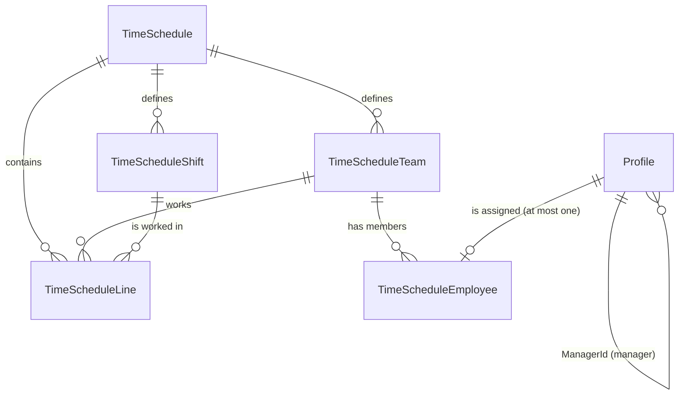
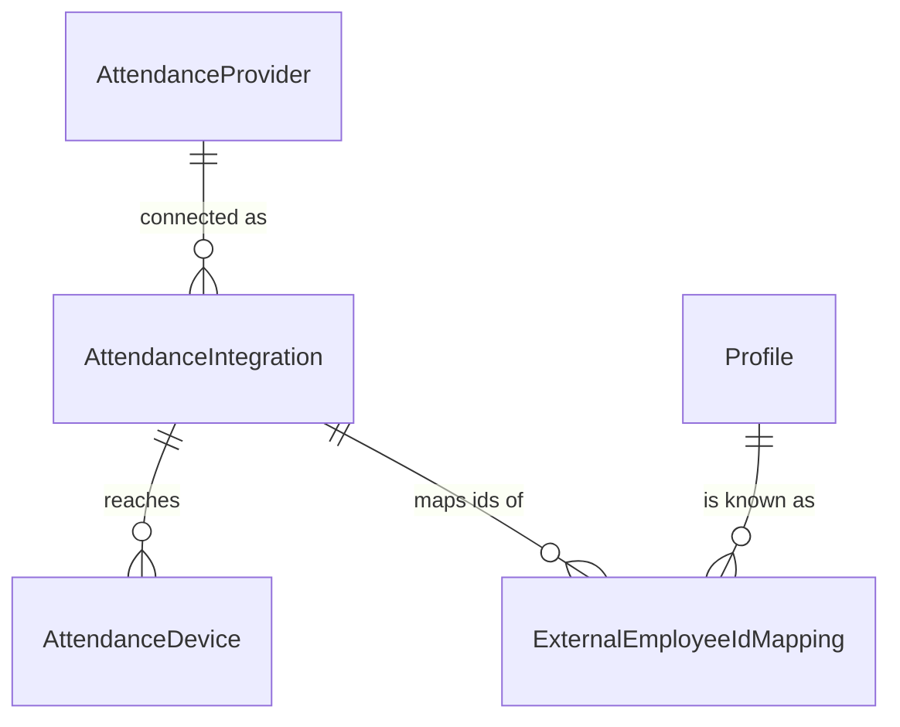
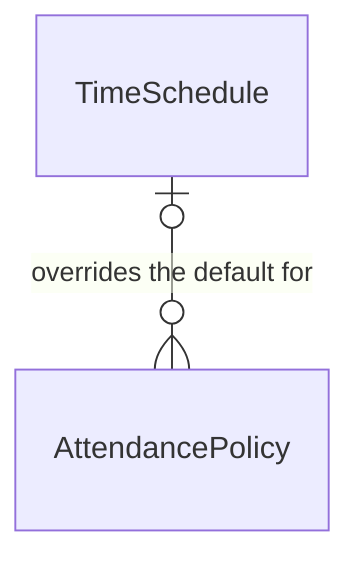
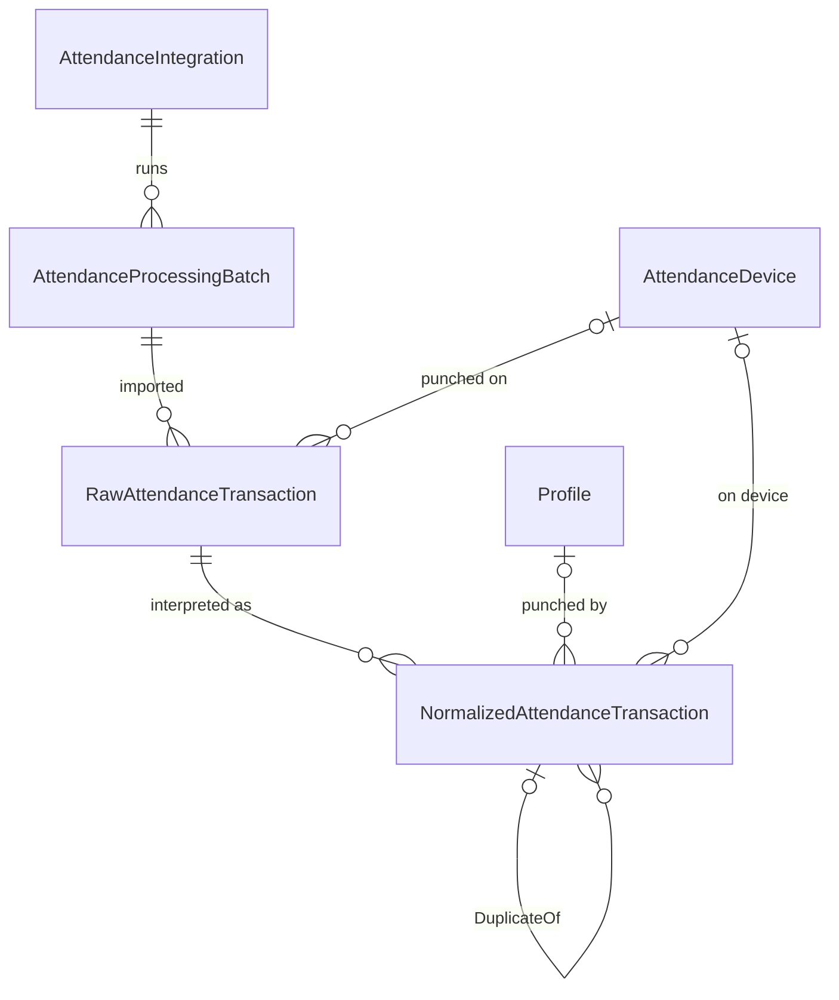
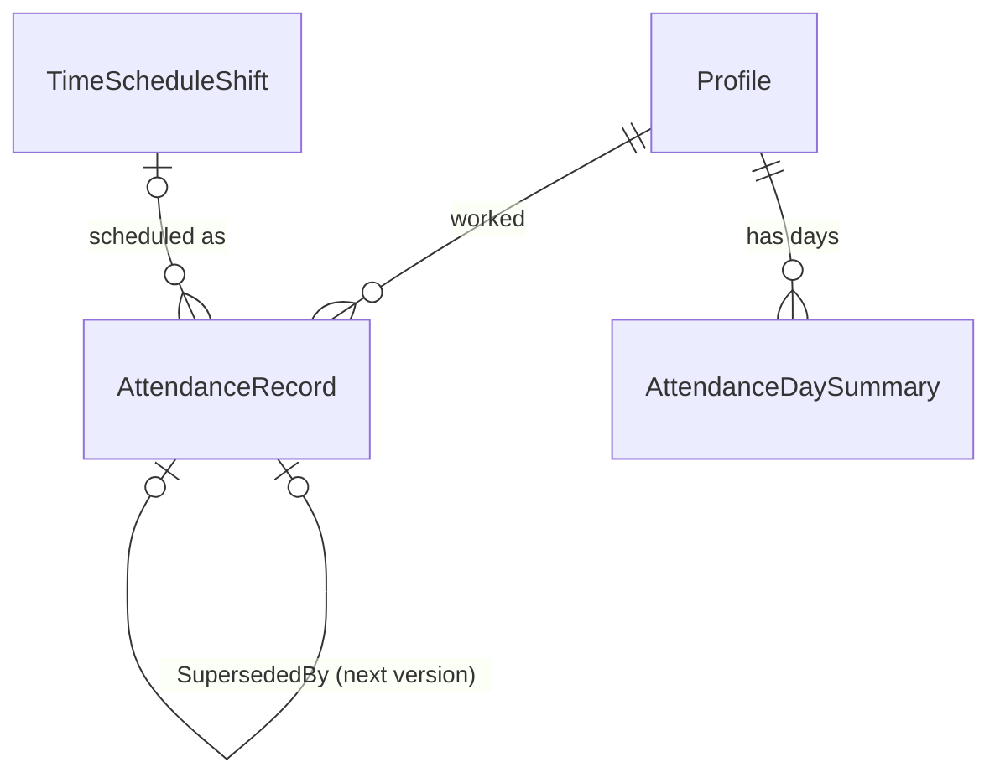
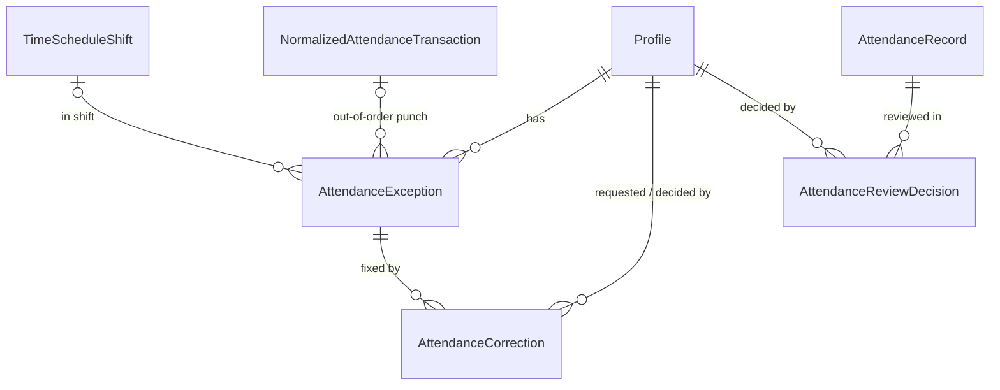
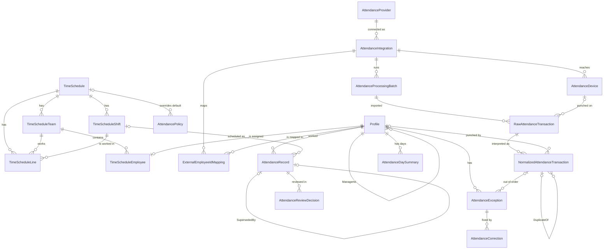

# Database structure — a guided tour

This guide builds the database up **one stage at a time**. Each stage adds a few tables, shows how they connect to what you already know, and explains every column, including the ones the system generates for you. By the end you will have seen all 21 tables and how a single punch on a time clock travels through them.

It was written from the entity classes, the EF Core configurations and the model snapshot (`src/robeem.Infrastructure/Persistence/Migrations/RobeemDbContextModelSnapshot.cs`), which is the source of truth if the two ever disagree. For the code architecture see [`README.md`](README.md); for the rules see [`CLAUDE.md`](CLAUDE.md).

## The route

| Section | You learn | New tables |
|---|---|---|
| **§1** | The story in one page | — |
| **§2** | Conventions every table follows | — |
| **§3 Part A** | **People and rosters**: who works, and when they should | `Profile`, `TimeSchedule`, `TimeScheduleShift`, `TimeScheduleTeam`, `TimeScheduleLine`, `TimeScheduleEmployee` |
| **§4 Part B** | **Connecting to time clocks**: vendors, devices, id mapping | `AttendanceProvider`, `AttendanceIntegration`, `AttendanceDevice`, `ExternalEmployeeIdMapping` |
| **§5 Part C** | **The rules**: rounding, grace, overtime, who approves | `AttendancePolicy` |
| **§6 Part D** | **Capturing punches**: raw, then cleaned | `AttendanceProcessingBatch`, `RawAttendanceTransaction`, `NormalizedAttendanceTransaction` |
| **§7 Part E** | **Calculating days**: what was actually worked | `AttendanceRecord`, `AttendanceDaySummary` |
| **§8 Part F** | **Problems and people**: exceptions, corrections, reviews | `AttendanceException`, `AttendanceCorrection`, `AttendanceReviewDecision` |
| **§9 Part G** | **Payroll gate and audit** | `PayPeriod`, `AttendanceAuditLog` |
| **§10** | The whole picture, one punch end to end, the rules the database enforces, a find-a-table index, handy queries | — |

Read it in order the first time. Later, use the index in §10.4 to jump to one table.

---

## 1. The story in one page

A company has **employees** (`Profile`). Each works to a **roster**: a repeating cycle of days, where on each cycle day a team works a particular **shift** (`TimeSchedule`, `TimeScheduleShift`, `TimeScheduleTeam`, `TimeScheduleLine`, `TimeScheduleEmployee`). That is what *should* happen.

What *did* happen comes from **time-clock machines**. A machine is made by a **vendor** (`AttendanceProvider`); the company connects to it through an **integration** (`AttendanceIntegration`), which reaches one or more **devices** (`AttendanceDevice`). The machine knows employees by its own ids, so a **mapping** says which real employee each id is (`ExternalEmployeeIdMapping`).

Every time someone punches, robeem first stores the event **exactly as received** (`RawAttendanceTransaction`, inside a `AttendanceProcessingBatch`), and never changes it. A second pass turns it into a clean, vendor-neutral event (`NormalizedAttendanceTransaction`): who, when, check-in or check-out, duplicate or not.

Then the **processing engine** lines the clean punches up against the roster, under the company's **rules** (`AttendancePolicy`), and writes what each person actually worked (`AttendanceRecord`, rolled up in `AttendanceDaySummary`).

When something is wrong, such as a missing check-out, the engine raises an **exception** (`AttendanceException`). It never invents the missing time. A person proposes a **correction** (`AttendanceCorrection`), a manager or HR approves it, and the day is recalculated. Overtime and unscheduled work need a **review** (`AttendanceReviewDecision`).

Finally **payroll** may read only days that are fully approved, have no open problem, and fall in a **pay period** (`PayPeriod`) that is not closed. Every sensitive action is written to an **audit log** (`AttendanceAuditLog`).

```
should work ─┐
 (roster)    │                           ┌─ problem? ─► exception ─► correction ─┐
             ├─► engine ─► record ─► day ┤                                      ├─► recalculated ─► payroll
 did work ───┘      ▲                    └─ overtime? ─► review ────────────────┘
 (punches)          └─ rules (policy)
```

Three principles explain most design choices:

1. **Raw data is never changed.** Everything downstream is derived, and corrections are *added*, never edited in.
2. **A missing punch is never invented.** It becomes an exception for a human.
3. **Every tenant is isolated.** Each company's data lives in its own database, and every row also carries its tenant id.

---

## 2. Conventions every table follows

You will see the same columns and rules everywhere. Learn them once here.

### 2.1 Engine, schemas and names

- **PostgreSQL.** **Each tenant has its own database** (`robeem_demo`, `robeem_acme`, …). All tenant databases have identical tables; migrations create them at startup.
- **Two schemas:** `HR` (people and rosters, §3) and `Attendance` (everything else). Write `"Attendance"."AttendanceRecord"`.
- **Names are PascalCase and case-sensitive**, so quote them in SQL: `SELECT "EmployeeId" FROM "Attendance"."AttendanceRecord"`.
- **Nothing is deleted by cascade.** Every foreign key is `RESTRICT`: history is removed deliberately, row by row.
- **Text comparison is case-sensitive**, so `E-1` and `e-1` are different values in a unique index.

### 2.2 Two kinds of table

| Kind | Tables | Columns it gets |
|---|---|---|
| **`Entity`**: things a person creates, views or approves | `Profile`, `TimeSchedule`, `TimeScheduleShift`, `TimeScheduleTeam`, `AttendanceProvider`, `AttendanceIntegration`, `AttendanceDevice`, `ExternalEmployeeIdMapping`, `AttendancePolicy`, `AttendanceRecord`, `AttendanceDaySummary`, `AttendanceException`, `AttendanceCorrection`, `AttendanceReviewDecision`, `PayPeriod` | `Id`, `GUID`, `CreatedOn`, `CreatedBy`, `ModifiedOn`, `ModifiedBy` (+ `Title` on five of them) |
| **`SystemEntity`**: high-volume, system-generated rows nobody "owns" | `TimeScheduleLine`, `TimeScheduleEmployee`, `AttendanceProcessingBatch`, `RawAttendanceTransaction`, `NormalizedAttendanceTransaction`, `AttendanceAuditLog` | **only** `Id` (the audit columns and `GUID` do not exist) |

### 2.3 The shared columns

| Column | Type | Meaning | Who fills it |
|---|---|---|---|
| `Id` | `integer`, identity | Primary key. | Database, automatically. |
| `GUID` | `uuid` | A second, globally unique identifier (`Entity` tables only). | System, at creation. |
| `CreatedOn` | `timestamp without time zone` | When the row was created, local wall-clock time (`Entity` tables only). | System, at creation. |
| `ModifiedOn` | `timestamp without time zone` | When the row last changed. | System: set to "now" on every update. |
| `CreatedBy`, `ModifiedBy` | `integer` | Intended to hold the id of the user who created / changed the row. | **Nothing fills them yet: they are always `0`.** Who did what is recorded in `AttendanceAuditLog` and in domain columns such as `RequestedByEmployeeId`, `ManagerDecidedById` and `DecidedById`. |
| `Title` | `varchar(255)` | A display name. **A real column only on `Profile`, `TimeSchedule`, `TimeScheduleShift`, `TimeScheduleTeam` and `AttendancePolicy`.** On every other table `Title` is computed in code from other columns (for example "Attendance 2026-10-05 v2" for `AttendanceRecord`) and does not exist in the database. | You, on those five tables. |
| `TenantId` | `varchar(64)`, not null | The tenant the row belongs to. | System: stamped on insert; never set by hand. See §2.4. |

In the table descriptions below, every table gets a line *shared columns* instead of repeating these.

### 2.4 `TenantId`: defense in depth

The database already belongs to one tenant, but **every table also has a required `TenantId`**. On tables whose entity implements `ITenantScoped` it is a normal property. On `TimeSchedule`, `TimeScheduleShift`, `TimeScheduleTeam`, `TimeScheduleLine` and `TimeScheduleEmployee` (supplied files that were not modified) it is a *shadow* column that exists only in the database.

- Every read is filtered to the current tenant.
- Every insert is stamped with it; inserting for another tenant throws.
- Changing or deleting another tenant's row throws.
- Every unique index starts with `TenantId`.

### 2.5 How .NET types become column types

| In the code | In PostgreSQL | Notes |
|---|---|---|
| `int` | `integer` | |
| `bool` | `boolean` | |
| `string` with a max length | `character varying(n)` | |
| `string` with no max length | `text` | Used for vendor-supplied values (so an oversized value can never block a row being stored), JSON payloads and error text. |
| `DateTime` | `timestamp without time zone` | **Local wall-clock time**, no zone. Paired with a `TimeZoneId` when the zone matters. |
| `DateTimeOffset` | `timestamp with time zone` | A real **instant**, always stored in UTC (any offset is lost on write). Used for punch and receipt times. |
| `TimeSpan` | `interval` | Durations such as hours worked. |
| `Guid` | `uuid` | |
| **enum** | `character varying(32)` holding the **member name**, e.g. `'CheckIn'` | Readable in SQL. Exception: `TimeSchedule.FirstCycleDay` (a .NET `DayOfWeek`) is an `integer`: 0 = Sunday … 6 = Saturday. |

### 2.6 Reading the column tables

*Null?* is **N** for required, **Y** for nullable. *Filled by* uses: **You** (entered by a user or by a vendor adapter), **System** (generated by the code, never typed in), **Derived** (computed from other data during processing).

---

## 3. Part A: People and rosters (schema `HR`)

**The question this answers:** *who works here, and when should each person work?*

Start with the simplest table, the employee. Then build the roster in four layers. A schedule defines a cycle, its shifts say *what* is worked, its teams say *who* shares a pattern, and its lines say *which team works which shift on which cycle day*.



### 3.1 `HR.Profile` — an employee

`Entity`. The code calls the employee by the *role* it plays (`EmployeeId` / `Employee`), but the table is `Profile`. Almost every later table points here.

| Column | Type | Null? | Meaning | Filled by |
|---|---|---|---|---|
| *shared columns* | | | `Title` is a real column here, kept equal to "First Last" | |
| `EmployeeNumber` | varchar(50) | N | The employee's number. **Unique per tenant.** | You |
| `FirstName` | varchar(100) | N | | You |
| `LastName` | varchar(100) | N | | You |
| `Email` | varchar(255) | Y | | You |
| `Phone` | varchar(50) | Y | | You |
| `Department` | varchar(100) | Y | | You |
| `JobTitle` | varchar(100) | Y | | You |
| `HireDate` | timestamp | N | Defaults to today. | You |
| `TerminationDate` | timestamp | Y | Empty while employed. | You |
| `IsActive` | boolean | N | Default true. Inactive employees can still be referenced by history. | You |
| `ManagerId` | integer → `Profile.Id` | Y | The employee's manager. A manager decides corrections and reviews for direct reports; for an employee with no (or an inactive) manager, HR decides. | You |

Indexes: unique `(TenantId, EmployeeNumber)`; `(LastName, FirstName)`; `(TenantId, ManagerId)`. `FullName` in code is computed and is not a column.

### 3.2 `HR.TimeSchedule` — a roster definition

`Entity`. Describes a repeating **cycle**. A weekly schedule has a 7-day cycle; a rotating shift pattern might have 14 or 28. `Title` is the schedule's name.

| Column | Type | Null? | Meaning | Filled by |
|---|---|---|---|---|
| *shared columns* | | | `Title` is a real column here | |
| `CyclePeriod` | integer | N | Length of the cycle in days (default 7). Cycle days are numbered 1..`CyclePeriod`. | You |
| `FirstCycleDay` | integer (`DayOfWeek`) | N | Which weekday is cycle day 1 when there is no anchor date yet. 0 = Sunday … 6 = Saturday; default 1 (Monday). | You |
| `Scheduling` | boolean | N | A flag used while the roster is being generated. | System |
| `LastScheduleDate` | timestamp | N | The anchor date used to work out cycle days. `0001-01-01` means "no anchor yet". | System |
| `LastScheduleDay` | integer | N | The cycle day that `LastScheduleDate` fell on (default 1). | System |
| `SystemSchedule` | boolean | N | True for schedules the system created (for example the seeded "Standard Week"). | System |
| `Description` | text | Y | | You |

**How a date becomes a cycle day:** `(LastScheduleDay + days since LastScheduleDate) mod CyclePeriod`, wrapped into 1..`CyclePeriod` (`TimeSchedule.GetCycleDay`). `CycleStartDay` in code is computed and is not a column.

### 3.3 `HR.TimeScheduleShift` — a shift of a schedule

`Entity` (through `TimeShiftEntity`). What is worked, as text `"HH:mm"`.

| Column | Type | Null? | Meaning | Filled by |
|---|---|---|---|---|
| *shared columns* | | | `Title` is a real column here (the shift's name) | |
| `TimeScheduleId` | integer → `TimeSchedule.Id` | N | The schedule it belongs to. | You |
| `StartTime` | varchar(5) | N | e.g. `09:00` (default). | You |
| `EndTime` | varchar(5) | N | e.g. `17:00`. **An end earlier than the start means the shift runs past midnight** (an overnight shift): `22:00`→`06:00`. | You |
| `Overtime` | boolean | N | Marks an overtime shift. | You |
| `BreakTime` | boolean | N | Whether the shift has a scheduled break. | You |
| `BreakStartTime` | varchar(5) | N | Default `00:00`; meaningful only when `BreakTime` is true. | You |
| `BreakEndTime` | varchar(5) | N | Same. | You |

Computed in code, **not columns**: `WorkHours`, `BreakHours`, `TotalHours`, the `Display*Time` values, and "is overnight".

### 3.4 `HR.TimeScheduleTeam` — a group that shares a pattern

`Entity`. Lets different people on one schedule work different shifts. `Title` is the team's name.

| Column | Type | Null? | Meaning | Filled by |
|---|---|---|---|---|
| *shared columns* | | | `Title` is a real column here | |
| `TimeScheduleId` | integer → `TimeSchedule.Id` | N | | You |
| `AllInclusive` | boolean | N | True for the schedule's **default team**, which stands for everyone assigned to the schedule. Assigning an employee to a schedule puts them in this team. | System / You |

### 3.5 `HR.TimeScheduleLine` — the roster itself

`SystemEntity` (so only `Id` and `TenantId` besides the columns below). One row says: **"on this cycle day, this team works this shift."** **No row for a team and cycle day means a day off.**

| Column | Type | Null? | Meaning | Filled by |
|---|---|---|---|---|
| `TimeScheduleId` | integer → `TimeSchedule.Id` | N | | You |
| `TeamId` | integer → `TimeScheduleTeam.Id` | N | | You |
| `ShiftId` | integer → `TimeScheduleShift.Id` | N | | You |
| `CycleDay` | integer | N | 1..`CyclePeriod`. | You |

Unique: `(TenantId, TimeScheduleId, TeamId, CycleDay, ShiftId)`. A team may have several lines on one cycle day (a split shift).

### 3.6 `HR.TimeScheduleEmployee` — who is on which schedule

`SystemEntity`. Connects people to the roster. An employee has **at most one** row.

| Column | Type | Null? | Meaning | Filled by |
|---|---|---|---|---|
| `TimeScheduleId` | integer → `TimeSchedule.Id` | N | | System (on assignment) |
| `TeamId` | integer → `TimeScheduleTeam.Id` | N | Normally the schedule's default (all-inclusive) team. | System (on assignment) |
| `EmployeeId` | integer → `Profile.Id` | N | | System |

Unique: `(TenantId, EmployeeId)`. An employee with **no row** is on no schedule; the system never guesses one.

### 3.7 Putting Part A together: what shift should employee 3 work on a date?

1. `TimeScheduleEmployee` for employee 3 gives the **schedule** and **team**.
2. `TimeSchedule.GetCycleDay(date)` turns the date into a **cycle day**.
3. `TimeScheduleLine` rows for that schedule, team and cycle day give the **shift id(s)**. None means a day off.
4. `TimeScheduleShift` gives the start, end and break times.

```sql
SELECT s."Title", s."StartTime", s."EndTime"
FROM "HR"."TimeScheduleEmployee" te
JOIN "HR"."TimeScheduleLine" l ON l."TimeScheduleId" = te."TimeScheduleId" AND l."TeamId" = te."TeamId"
JOIN "HR"."TimeScheduleShift" s ON s."Id" = l."ShiftId"
WHERE te."EmployeeId" = 3 AND l."CycleDay" = 1;
```

This is exactly what the attendance engine asks (the cycle day is computed in code, not SQL). **You now know what *should* happen. Next: how the real punches get in.**

---

## 4. Part B: Connecting to time clocks (schema `Attendance`)

**The question this answers:** *where do punches come from, and whose are they?*

Four tables, in a chain: a **provider** (the vendor) → an **integration** (our connection to it) → **devices** (the machines) and **id mappings** (the vendor's employee ids → our employees).



### 4.1 `Attendance.AttendanceProvider` — the vendor catalog

`Entity`. The vendors robeem can talk to (for example `generic-csv`, `zkteco`, a BioStar server, a webhook). Seeded at startup, then yours to manage: you add, edit and deactivate providers on the *Providers* screen. A provider is **usable** when it is active and has a `DefaultFileFormatId` (a vendor of exported files: no code needed) or a code adapter registered under its `ProviderKey` (a vendor pulled over an API or pushing webhooks).

| Column | Type | Null? | Meaning | Filled by |
|---|---|---|---|---|
| *shared columns* | | | no `Title` column (it is `DisplayName` in code) | |
| `ProviderKey` | varchar(100) | N | Stable key a code adapter is registered under, e.g. `suprema-biostar`. **Unique per tenant; never changes.** | You (seed) |
| `DisplayName` | varchar(255) | N | | You (seed) |
| `Manufacturer` | varchar(255) | N | Company that makes the devices; empty if unknown. | You (seed) |
| `WebsiteUrl` | varchar(255) | N | Manufacturer's site; empty if unknown. | You (seed) |
| `DefaultFileFormatId` | integer → `AttendanceFileFormat.Id` | Y | The layout an upload is read by when its integration names none. | You (seed) |
| `SupportedTransports` (code name `LegacySupportedTransports`) | varchar(255) | N | **Old.** The transports as comma-separated text. Read once by the seeder into `AttendanceProviderTransport`, then emptied; to be dropped by a later migration. | System |
| `SupportsWebhooks` | boolean | N | | You (seed) |
| `SupportsIncrementalSync` | boolean | N | Whether the adapter can fetch "only what is new". | You (seed) |
| `IsActive` | boolean | N | Whether integrations can be made with it (with a format or an adapter behind it). | You (seed) |

The transports a provider offers (besides file upload, which every provider has) are rows of **`Attendance.AttendanceProviderTransport`** (`ProviderId`, `TransportId`; unique together per tenant), pointing at **`Attendance.AttendanceTransportDefinition`**: one row per `AttendanceTransport` (`FileUpload`, `Sftp`, `RestApi`, `Webhook`, `Database`, `DeviceSdk`) with a `DisplayName` you can change, `IsPull` and `UsesFileFormat` (fixed by what the transport is), and `IsActive`. **`Attendance.AttendanceDeviceType`** (`Name`, `IsActive`) lists the kinds of device (`Biometric`, `Facial`, `RFID`, `Mobile`, `Cloud`, `OnPrem` to start with) and is yours to extend.

### 4.2 `Attendance.AttendanceIntegration` — the tenant's connection

`Entity`. One row per configured connection (for example "Head office ZKTeco"). It also remembers how far a scheduled pull has got.

| Column | Type | Null? | Meaning | Filled by |
|---|---|---|---|---|
| *shared columns* | | | no `Title` column (it is `DisplayName`) | |
| `ProviderId` | integer → `AttendanceProvider.Id` | N | | You |
| `DisplayName` | varchar(255) | N | | You |
| `ConnectionConfigRef` | varchar(255) | N | A **reference** to the connection settings in secret storage, never the secret itself. | You |
| `PollingScheduleCron` | varchar(100) | Y | Cron expression for scheduled pulls; empty means no scheduled sync. | You |
| `SyncCursor` | text | Y | The **high-water mark** of incremental sync (its shape is the provider's, e.g. a timestamp). Moves only after the batch's raw rows are committed. | System |
| `LastSuccessfulSyncAt` | timestamp | Y | | System |
| `Status` | varchar(32) | N | `Active`, `Paused`, `Failed`. | You / System |
| `HealthStatus` | varchar(32) | N | `Unknown`, `Healthy`, `Degraded` (a sync failed), `Unhealthy` (circuit breaker opened). Written by the sync job only. | System |

### 4.3 `Attendance.AttendanceDevice` — a punch device

`Entity`. A physical or logical machine reached through an integration.

| Column | Type | Null? | Meaning | Filled by |
|---|---|---|---|---|
| *shared columns* | | | no `Title` column (it is `Name`) | |
| `IntegrationId` | integer → `AttendanceIntegration.Id` | N | | You / System (discovered) |
| `ExternalDeviceId` | varchar(100) | N | The device id exactly as the vendor reports it. **Unique per integration.** | You / System |
| `Name` | varchar(255) | N | | You |
| `DeviceTypeId` | integer → `AttendanceDeviceType.Id` | Y | The kind of device. Empty only for a device saved before types were a table (the seeder fills it in). | You |
| `DeviceType` (code name `LegacyDeviceType`) | varchar(32) | N | **Old.** The type as text. Read once by the seeder into `DeviceTypeId`, then emptied; to be dropped by a later migration. | System |
| `Model` | varchar(100) | N | e.g. `U350`; empty if unknown. | You |
| `SoftwareVersion` | varchar(100) | N | Version of the vendor's attendance software; empty if unknown. | You |
| `SdkVersion` | varchar(50) | N | Version of the vendor SDK; empty if unknown. | You |
| `TimeZoneId` | varchar(64) | N | IANA zone the device's local times are in, e.g. `Asia/Beirut`. **Drives how a punch's UTC instant becomes local time** (§6). | You |
| `LastSeenAt` | timestamp | Y | | System |

### 4.4 `Attendance.ExternalEmployeeIdMapping` — the vendor's id → our employee

`Entity`. A machine knows "E-1001"; robeem knows `Profile` 3. This table is the bridge. An unmapped id is flagged, never guessed.

| Column | Type | Null? | Meaning | Filled by |
|---|---|---|---|---|
| *shared columns* | | | no `Title` column (it is `ExternalEmployeeId`) | |
| `IntegrationId` | integer → `AttendanceIntegration.Id` | N | | You |
| `ExternalEmployeeId` | varchar(255) | N | The id exactly as the vendor sends it (case-sensitive). | You |
| `EmployeeId` | integer → `Profile.Id` | N | | You |

Unique: `(TenantId, IntegrationId, ExternalEmployeeId)`.

**You now know who exists, what they should work, and where punches come from. Before capturing punches, one more table: the rules.**

---

## 5. Part C: The rules (`AttendancePolicy`)

**The question this answers:** *how strict is this company, and who has to approve changes?*

One policy per schedule, plus one tenant-wide default. It is placed before the punch tables because normalization already uses one of its settings (the duplicate window).



### 5.1 `Attendance.AttendancePolicy`

`Entity`. A schedule's own policy wins; if it has none, the tenant default (`TimeScheduleId` null) applies. `Title` is the policy's name.

| Column | Type | Null? | Meaning | Filled by |
|---|---|---|---|---|
| *shared columns* | | | `Title` is a real column here | |
| `TimeScheduleId` | integer → `TimeSchedule.Id` | Y | The schedule it applies to; **null means the tenant default**. | You |
| `RoundingRuleMinutes` | integer | N | Rounds punches to this many minutes; 0 means no rounding. | You |
| `LateGraceMinutes` | integer | N | Minutes late that are not counted as late. | You |
| `EarlyDepartureGraceMinutes` | integer | N | Minutes early that are not counted. | You |
| `OvertimeThresholdMinutes` | integer | N | Minutes beyond the shift before overtime starts. | You |
| `RequiresOvertimePreApproval` | boolean | N | If true, overtime needs an approving review decision before payroll (§8). | You |
| `CorrectionApprovalWorkflow` | varchar(32) | N | Who approves a correction: `Manager`, `HR`, `Both`. | You |
| `UnlabeledPunchInterpretationMode` | varchar(32) | N | What to do with a punch that has no in/out label: `Off` (reject it), `Sequential` (alternate in/out), `RulesEngine`. Anything inferred is marked `Inferred`. | You |
| `DuplicateTimeWindowSeconds` | integer | N | Width of the time bucket in the duplicate key (default 120). See §6.3. | You |
| `MissingPunchGraceMinutes` | integer | N | How long after a shift ends an absent punch waits before an exception is raised (default 120). | You |

Unique: one default per tenant (`TenantId` where `TimeScheduleId IS NULL`); one per schedule (`TenantId, TimeScheduleId` where `TimeScheduleId IS NOT NULL`).

---

## 6. Part D: Capturing punches

**The question this answers:** *what exactly did the machines tell us, and what do those events mean?*

The key idea is **two copies of every punch**. The first is stored the instant it arrives and never touched. The second is a cleaned-up interpretation made later, in the background.



### 6.1 `Attendance.AttendanceProcessingBatch` — one run

`SystemEntity`. A sync, an upload or a webhook delivery. Every raw punch records the batch that imported it, so you can always answer "which import brought this in?".

| Column | Type | Null? | Meaning | Filled by |
|---|---|---|---|---|
| `IntegrationId` | integer → `AttendanceIntegration.Id` | Y | Null for a reprocess run spanning integrations. | System |
| `BatchType` | varchar(32) | N | `InitialSync`, `IncrementalSync`, `Reprocess`, `ManualUpload`, `Reconciliation`, `Webhook`. | System |
| `StartedAt` | timestamp | N | | System |
| `CompletedAt` | timestamp | Y | Null while running. | System |
| `Status` | varchar(32) | N | `Running`, `Succeeded`, `Failed`, `PartiallyFailed`. | System |
| `RecordsIngested` | integer | N | Rows stored in this run. | System |
| `RecordsFailed` | integer | N | Rows stored but marked failed (for example an unreadable payload). | System |
| `ErrorSummary` | text | Y | | System |

Empty batches from successful syncs are pruned nightly.

### 6.2 `Attendance.RawAttendanceTransaction` — the punch as received

`SystemEntity`. **Immutable.** One row for every event from every source, valid or not, duplicates included. The database layer rejects a delete, and rejects any update except the three bookkeeping columns marked ◆.

Why keep everything? Because it is the evidence. If a rule or a mapping later turns out wrong, the original is still there to reprocess from.

| Column | Type | Null? | Meaning | Filled by |
|---|---|---|---|---|
| `IntegrationId` | integer → `AttendanceIntegration.Id` | N | | System |
| `DeviceExternalId` | text | Y | Device id exactly as the vendor sent it. | You (adapter) |
| `DeviceId` | integer → `AttendanceDevice.Id` | Y | The resolved device, if known at ingestion. | Derived |
| `ExternalTransactionId` | text | Y | The vendor's own id for this event. | You (adapter) |
| `ExternalEmployeeId` | text | Y | The employee id as the vendor sent it. | You (adapter) |
| `TransactionTimestampRaw` | text | N | The timestamp **exactly as sent**, offset included. Kept because the offset is lost in the parsed column. | You (adapter) |
| `TransactionTimestampParsed` | timestamptz | Y | The parsed instant, UTC; null if it could not be parsed. Uses the device's time zone when the text had none. | Derived |
| `TransactionTypeRaw` | text | Y | The vendor's event type, as sent. | You (adapter) |
| `DirectionRaw` | text | Y | The vendor's direction (in/out), as sent. | You (adapter) |
| `RawPayload` | text | N | The vendor's record as JSON, **after biometric fields were removed** by the sanitizer. `{}` if it could not be checked. | System |
| `SourceSystem` | varchar(255) | N | The provider key (or upload file name) the event came from. | System |
| `ImportBatchId` | integer → `AttendanceProcessingBatch.Id` | N | | System |
| `ApiRequestReference` | text | Y | A reference to the request that delivered it, when one exists. | System |
| `RecordReceivedAt` | timestamptz | N | When robeem received it (UTC). | System |
| `ProcessingStatus` ◆ | varchar(32) | N | `Pending` → `Normalized`, or `Failed`, or `Skipped`. | System |
| `ProcessingError` ◆ | text | Y | Why normalization failed, if it did. | System |
| `RecordHash` | varchar(128) | N | Lower-case hex **SHA-256 of `"{integrationId}\n{RawPayload}"`**. A fingerprint, **not unique**: duplicates are stored on purpose. | System |
| `RetentionStatus` ◆ | varchar(32) | N | `Active`, `Archived`, `PendingDeletion`. | System |

Indexes: `(TenantId, RecordHash)`; `(TenantId, ImportBatchId, ProcessingStatus)`. Vendor strings are unbounded `text` so storing can never fail on length.

### 6.3 `Attendance.NormalizedAttendanceTransaction` — the punch, interpreted

`SystemEntity`. Vendor-neutral. A background job reads each pending raw row and writes one normalized row: it resolves the employee through the mapping (§4.4), the device (§4.3), reads the timestamp with the vendor's own rules, and decides the event type. A duplicate is **kept as a row too**, marked, never dropped.

| Column | Type | Null? | Meaning | Filled by |
|---|---|---|---|---|
| `EmployeeId` | integer → `Profile.Id` | Y | Null while the vendor's employee id is unmapped. | Derived |
| `AttendanceDate` | timestamp | N | The calendar date (local) the punch counts towards. | Derived (local date of the punch) |
| `EventTimestampUtc` | timestamptz | N | The instant of the punch, UTC. | Derived (= the parsed raw time) |
| `EventTimestampLocal` | timestamp | N | The same instant as wall-clock time **in `TimeZoneId`**. | Derived |
| `TimeZoneId` | varchar(64) | N | IANA zone of the local time: the device's zone, or `UTC` when the device is unknown. | Derived |
| `NormalizedEventType` | varchar(32) | N | `CheckIn`, `CheckOut`, `BreakOut`, `BreakIn`, `Unknown` (unlabeled), `Other`. | Derived (via the vendor's interpreter) |
| `OriginalEventType` | text | Y | The vendor's type/direction as received, for traceability. | Derived |
| `DeviceId` | integer → `AttendanceDevice.Id` | Y | | Derived |
| `IntegrationId` | integer → `AttendanceIntegration.Id` | N | | System |
| `RawTransactionId` | integer → `RawAttendanceTransaction.Id` | N | The raw row it came from. | System |
| `EventSource` | varchar(32) | N | `Device`, `MobileApp`, `WebPortal`, `Manual`. | System |
| `ConfidenceStatus` | varchar(32) | N | `Certain` (vendor labelled it), `Inferred` (type assigned by policy), `Ambiguous` (unlabeled, waiting). | Derived |
| `ProcessingStatus` | varchar(32) | N | `Pending`, `Processed`, `Excluded`. | System |
| `DuplicateStatus` | varchar(32) | N | `Unique`, `DuplicateConfirmed`, `DuplicateCandidate`. | Derived |
| `DuplicateOfTransactionId` | integer → this table | Y | The earlier row this one duplicates. | Derived |
| `ExceptionStatus` | varchar(32) | N | `None`, `FlaggedInvalidSequence`, `FlaggedUnrecognizedEmployee`, `FlaggedUnrecognizedDevice`. | Derived |
| `DuplicateBucketTimestampUtc` | timestamptz | N | `EventTimestampUtc` rounded **down** to the policy's `DuplicateTimeWindowSeconds` (§5.1). Part of the duplicate key. | Derived |

**The duplicate key.** A unique index on `(TenantId, EmployeeId, DeviceId, NormalizedEventType, DuplicateBucketTimestampUtc)`, **filtered to rows whose `DuplicateStatus = 'Unique'`**. Two punches of the same person, device and type within the same time bucket collide, so the second becomes a duplicate row instead of a second punch.

**The "local" columns exist for a reason.** A person punches in at 08:58 *local* time; the instant is the same for everyone, but the *day* it counts towards depends on the zone. So the table keeps the instant (`EventTimestampUtc`), the local clock reading (`EventTimestampLocal`), and the zone that connects them (`TimeZoneId`).

**You now have clean punches. Next: compare them with the roster.**

---

## 7. Part E: Calculating days

**The question this answers:** *for each employee and day, what was actually worked compared with what was scheduled?*

The engine takes an employee-day, finds the expected shifts (Part A), applies the policy (Part C), pairs up the clean punches (Part D), and writes the result.



Two tables, two levels of detail: a **record** per shift, and a **day summary** per employee-day.

### 7.1 `Attendance.AttendanceRecord` — one shift, calculated (and versioned)

`Entity`. **Never edited in place.** A recalculation that changes anything writes a new row with `Version + 1` and retires the old one. So the history of "what did we think the hours were, and when did that change?" is always there. All times are local wall-clock times. `AttendanceDate` is the date the shift **starts**, also for an overnight shift.

| Column | Type | Null? | Meaning | Filled by |
|---|---|---|---|---|
| *shared columns* | | | no `Title` column | |
| `EmployeeId` | integer → `Profile.Id` | N | | Derived |
| `AttendanceDate` | timestamp | N | Date the shift starts on. | Derived |
| `TimeScheduleShiftId` | integer → `TimeScheduleShift.Id` | Y | The scheduled shift; **null means work outside any scheduled shift**. | Derived |
| `ScheduledStart` / `ScheduledEnd` | timestamp | Y | The shift's start and end on that date (the end is on the next day for an overnight shift). | Derived |
| `ActualCheckIn` / `ActualCheckOut` | timestamp | Y | The punches used. Null means absent (never invented). | Derived |
| `ActualBreakOut` / `ActualBreakIn` | timestamp | Y | The break punches used. | Derived |
| `ActualCheckInSource`, `ActualCheckOutSource`, `ActualBreakOutSource`, `ActualBreakInSource` | varchar(32) | Y | Where each punch came from: `Normalized` (a device punch), `Inferred` (type assigned by policy), `Corrected` (an applied correction, §8.2). | Derived |
| `WorkingHours` | interval | N | Time worked, breaks excluded. | Derived |
| `BreakDuration` | interval | N | | Derived |
| `LateMinutes` | integer | N | After the late grace. | Derived |
| `EarlyDepartureMinutes` | integer | N | After the early-departure grace. | Derived |
| `OvertimeMinutes` | integer | N | Beyond the overtime threshold. | Derived |
| `Status` | varchar(32) | N | `Calculated`, `PendingReview` (needs a person, §8.3), `Approved`, `Rejected`. | Derived, then moved by a review decision |
| `SourceNormalizedTransactionIds` | text | Y | Ids of the normalized punches used: comma-separated, ascending. This is how a record can always say *which punches it was built from*. | Derived |
| `SourceCorrectionIds` | text | Y | Ids of the applied corrections used. | Derived |
| `Version` | integer | N | 1, 2, 3… | System |
| `IsCurrent` | boolean | N | True only for the latest version of this employee/date/shift. **Always read with `IsCurrent = true`.** | System |
| `SupersededByRecordId` | integer → this table | Y | The version that replaced this one; null while current. | System |

Indexes: unique `(TenantId, EmployeeId, AttendanceDate, TimeScheduleShiftId, Version)`; `(TenantId, EmployeeId, AttendanceDate, IsCurrent)`. (PostgreSQL treats nulls as distinct, so the uniqueness does not apply to unscheduled work, where `TimeScheduleShiftId` is null.)

### 7.2 `Attendance.AttendanceDaySummary` — one employee-day

`Entity`. A derived rollup of that date's current records, **recomputed in place** each time the day is processed (the one place a calculated value is overwritten, because it holds no history of its own: the records do). One row per employee per day.

| Column | Type | Null? | Meaning | Filled by |
|---|---|---|---|---|
| *shared columns* | | | no `Title` column | |
| `EmployeeId` | integer → `Profile.Id` | N | | Derived |
| `AttendanceDate` | timestamp | N | | Derived |
| `TotalWorkingHours` | interval | N | Sum over the day's current records. | Derived |
| `TotalOvertimeHours` | interval | N | | Derived |
| `TotalBreakHours` | interval | N | | Derived |
| `ShiftCount` | integer | N | Number of current records, unscheduled work included. | Derived |
| `ExceptionCount` | integer | N | Exceptions of that day that are not closed. | Derived |
| `Status` | varchar(32) | N | The day's status: `Approved` only if every record is. | Derived |

Unique: `(TenantId, EmployeeId, AttendanceDate)`.

**Everything so far assumed the punches were complete and the numbers uncontroversial. Real life isn't.**

---

## 8. Part F: Problems and people

**The question this answers:** *what happens when the data is wrong or needs a decision, and how is that recorded?*

Three tables, each **added** to the picture, never editing what is already there.



### 8.1 `Attendance.AttendanceException` — a problem for a person

`Entity`. Raised by the engine for a **missing punch** or an **invalid sequence**. It never fixes anything and never invents a punch. It belongs to *employee + date + shift*, **not to one record version**: records are replaced on every recalculation, but the exception stays until it is resolved. Raised once however often the day is processed.

| Column | Type | Null? | Meaning | Filled by |
|---|---|---|---|---|
| *shared columns* | | | no `Title` column (computed, e.g. "Missing CheckOut — 10/5/2026") | |
| `EmployeeId` | integer → `Profile.Id` | N | | Derived |
| `AttendanceDate` | timestamp | N | Date of the shift (start date if overnight). | Derived |
| `TimeScheduleShiftId` | integer → `TimeScheduleShift.Id` | Y | Null for work outside any shift. | Derived |
| `ExceptionType` | varchar(32) | N | `MissingPunch`, `InvalidSequence`. | Derived |
| `MissingEventType` | varchar(32) | Y | Which punch is absent. Set only for `MissingPunch`. | Derived |
| `RelatedNormalizedTransactionId` | integer → `NormalizedAttendanceTransaction.Id` | Y | The out-of-order punch. Set only for `InvalidSequence`. | Derived |
| `Status` | varchar(32) | N | `Open`, `PendingCorrection`, `Closed`. A day with an exception that is not `Closed` can never be `Approved`. | System |
| `Description` | varchar(500) | N | Human-readable explanation. | Derived |
| `DetectedAt` | timestamp | N | When it was raised (local time). | System |
| `ResolvedAt` | timestamp | Y | When it was closed. | System |
| `ResolutionMethod` | varchar(32) | Y | `AutoResolved` (the problem went away, e.g. a late punch arrived) or `Correction`. | System |

Indexes: `(TenantId, EmployeeId, AttendanceDate)`; `(TenantId, Status)`. `IsActive` in code is computed.

### 8.2 `Attendance.AttendanceCorrection` — a proposed fix

`Entity`, a workflow entity. Today a correction can only **supply the missing punch** of a `MissingPunch` exception. It is a *new row* referencing the exception; raw and normalized punches are never touched. Once `Applied`, the engine reads it as a punch whose source is `Corrected`, and the day is recalculated into a new record version (§7.1).

Life of a correction: `Pending` → (manager and/or HR decide, per the policy's workflow) → `Approved` → `Applied`, or `Rejected` (the employee may propose again).

| Column | Type | Null? | Meaning | Filled by |
|---|---|---|---|---|
| *shared columns* | | | no `Title` column | |
| `AttendanceExceptionId` | integer → `AttendanceException.Id` | N | The exception being fixed. | You |
| `EmployeeId` | integer → `Profile.Id` | N | The exception's employee. | System |
| `AttendanceDate` | timestamp | N | The exception's shift date. | System |
| `CorrectedEventType` | varchar(32) | N | The punch supplied (the exception's missing punch). | System |
| `ProposedValue` | timestamp | N | **When the punch happened** (local time), as the employee says. | You |
| `TimeZoneId` | varchar(64) | N | Zone of `ProposedValue`, fixed when proposed so the instant never shifts. | System |
| `Justification` | varchar(1000) | N | Why. | You |
| `RequestedByEmployeeId` | integer → `Profile.Id` | N | Who proposed it (from the signed-in user, never from the request body). | System |
| `RequestedAt` | timestamp | N | | System |
| `ApprovalWorkflow` | varchar(32) | N | `Manager`, `HR` or `Both`, **copied from the policy at proposal time** so a later policy change does not alter a correction under review. | System |
| `Status` | varchar(32) | N | `Pending`, `Approved`, `Rejected`, `Applied`. | System |
| `ManagerDecision` | varchar(32) | Y | `Approved` / `Rejected`. | System |
| `ManagerDecidedById` | integer → `Profile.Id` | Y | | System |
| `ManagerDecidedAt` | timestamp | Y | | System |
| `HrDecision` | varchar(32) | Y | `Approved` / `Rejected`. | System |
| `HrDecidedById` | integer → `Profile.Id` | Y | | System |
| `HrDecidedAt` | timestamp | Y | | System |
| `AppliedAt` | timestamp | Y | When it was folded into the calculation. | System |

Indexes: **unique `(TenantId, AttendanceExceptionId)` only while the correction is `Pending` or `Approved`** (one live correction per exception; a rejected one lets the employee propose again); `(TenantId, EmployeeId, ProposedValue)`; `(TenantId, Status)`.

### 8.3 `Attendance.AttendanceReviewDecision` — a reviewer's decision on a record

`Entity`. Some records need a human even when no punch is missing: overtime under a pre-approval policy, work outside any shift, an incomplete day. Those records are `PendingReview`. A decision is **additive**: the record's numbers are never edited, only its review status moves, and this row says who moved it. It belongs to one record **version**, so a recalculation that changes the numbers needs a new decision ("an approval of 1:23 of overtime never covers 2:00").

| Column | Type | Null? | Meaning | Filled by |
|---|---|---|---|---|
| *shared columns* | | | no `Title` column | |
| `AttendanceRecordId` | integer → `AttendanceRecord.Id` | N | The record version reviewed. | System |
| `EmployeeId` | integer → `Profile.Id` | N | Copied from the record, for queries. | System |
| `AttendanceDate` | timestamp | N | Copied from the record, for queries. | System |
| `Outcome` | varchar(32) | N | `Approved` / `Rejected`. | You |
| `DecidedById` | integer → `Profile.Id` | N | The reviewer (from the signed-in user). | System |
| `DecidedByRole` | varchar(32) | N | `Manager` or `HR`: the capacity they decided in. | System |
| `DecidedAt` | timestamp | N | | System |
| `Reason` | varchar(1000) | Y | Required for a rejection. | You |
| `OvertimeMinutes` | integer | N | The overtime the record had when decided, so the decision states what it covered. | System |

Indexes: unique `(TenantId, AttendanceRecordId)`; `(TenantId, AttendanceDate, Outcome)`.

**By now a day can reach `Approved`. The last stage controls who may rely on it.**

---

## 9. Part G: Payroll gate and audit

**The question this answers:** *which days may payroll pay for, and who can prove who did what?*

These two tables stand apart from the rest: neither has a foreign key.

- A **pay period** is matched to attendance by **date range** (`StartDate` to `EndDate`), not by a link.
- An **audit line** names its subject by **type and id as text** (`TargetType`, `TargetId`), so a log line is never blocked by, or lost with, the thing it describes.

### 9.1 `Attendance.PayPeriod`

`Entity`. A stand-in for a Payroll module that does not exist. Payroll reads a day only when **no closed pay period contains its date**.

| Column | Type | Null? | Meaning | Filled by |
|---|---|---|---|---|
| *shared columns* | | | no `Title` column ("2026-10-01 to 2026-10-31") | |
| `StartDate` | timestamp | N | First date (a date, no time). | You |
| `EndDate` | timestamp | N | Last date, inclusive. | You |
| `IsClosed` | boolean | N | Closing ends payroll extraction of the period; it can be reopened. | You |

Unique: `(TenantId, StartDate, EndDate)`.

**What payroll may read.** Only through one code path (`IPayrollAttendanceExtract`), never the raw or normalized tables. A day is returned *whole or not at all*, and only when: its summary and every current record are `Approved`; no exception of that employee and date is `Open` or `PendingCorrection`; overtime under a pre-approval policy has an approving `AttendanceReviewDecision` for that exact record version; and no closed `PayPeriod` contains the date.

### 9.2 `Attendance.AttendanceAuditLog` — who did or read what

`SystemEntity`. **Insert-only**: an update or delete throws. Written in the same transaction as the action it records, so a change and its log line commit or roll back together. Covers every correction decision, every exception status change and every direct read of raw or normalized attendance.

| Column | Type | Null? | Meaning | Filled by |
|---|---|---|---|---|
| `Actor` | varchar(100) | N | `employee:{Profile.Id}`, or `system` for background work. | System |
| `Action` | varchar(100) | N | What happened (see `AuditActionCatalog` in `robeem.Contracts`). | System |
| `TargetType` | varchar(200) | N | The type of entity concerned; several, comma-separated, for a read across tables. | System |
| `TargetId` | integer | Y | The entity's id; null for a read. | System |
| `Timestamp` | timestamptz | N | When (UTC). | System |
| `Details` | varchar(2000) | Y | Extra context. | System |

Indexes: `(TenantId, Action, Id)`; `(TenantId, TargetType, TargetId)`.

---

## 10. The whole picture

### 10.1 All tables and how they connect

You have now met every table. Here is the complete map. Read it left to right: roster and vendor setup on the left, the punch pipeline in the middle, people and decisions on the right.



(`PayPeriod` and `AttendanceAuditLog` are left out: they have no foreign keys, see §9.)

Two relationships are deliberately **not** foreign keys, because the thing they point at is replaced or derived:

- `AttendanceException` belongs to an *employee + date + shift*, not to one `AttendanceRecord`: records are replaced on every recalculation, the exception stays until resolved.
- `AttendanceRecord.SourceNormalizedTransactionIds` / `SourceCorrectionIds` hold lists of ids as text, as a record of what the calculation used.

### 10.2 One punch, end to end

Follow a single punch through the tables to see where each generated value comes from.

```
Vendor sends: { employee "E-1001", device "D7", time "2026-10-05T08:58:00+03:00", type "IN" }
        │
        ▼  RawAttendanceTransaction                     (immutable, stored unconditionally)
   ExternalEmployeeId = "E-1001"   DeviceExternalId = "D7"
   TransactionTimestampRaw = "2026-10-05T08:58:00+03:00"      ← text exactly as sent
   TransactionTimestampParsed = 2026-10-05 05:58:00Z           ← UTC instant
   TransactionTypeRaw = "IN"
   RawPayload = {...}   RecordHash = sha256("{integrationId}\n{RawPayload}")
   ImportBatchId → AttendanceProcessingBatch                  ProcessingStatus = Pending
        │
        ▼  NormalizedAttendanceTransaction                (NormalizationJob, asynchronous)
   EmployeeId = (ExternalEmployeeIdMapping "E-1001")          ← null + FlaggedUnrecognizedEmployee if unmapped
   DeviceId   = (AttendanceDevice "D7")                       TimeZoneId = device's zone
   EventTimestampUtc = 05:58:00Z     EventTimestampLocal = 08:58:00  (in TimeZoneId)
   AttendanceDate = 2026-10-05       NormalizedEventType = CheckIn   ConfidenceStatus = Certain
   DuplicateBucketTimestampUtc = 05:58:00Z rounded down to the policy window
   DuplicateStatus = Unique | DuplicateConfirmed              ← decided by the unique duplicate key
   (raw row's ProcessingStatus → Normalized)
        │
        ▼  AttendanceRecord + AttendanceDaySummary + AttendanceException    (processing engine)
   shift looked up from TimeScheduleEmployee → TimeScheduleLine → TimeScheduleShift
   ActualCheckIn = 08:58 (source Normalized)   LateMinutes / WorkingHours / OvertimeMinutes
   from AttendancePolicy (rounding, grace, thresholds)
   missing CheckOut → AttendanceException(MissingPunch, MissingEventType = CheckOut)
        │
        ▼  AttendanceCorrection → AttendanceReviewDecision                     (people)
   applied correction → engine writes AttendanceRecord Version 2, retires Version 1
        │
        ▼  Payroll reads only through IPayrollAttendanceExtract
   approved record + approved summary + no open exception + period not closed
```

The engine currently runs when HR reprocesses a day and after a correction or review decision; nothing schedules it after normalization yet (see `README.md` §7).

### 10.3 Rules the database layer enforces

| Rule | Enforced by |
|---|---|
| A raw punch is never deleted, and only `ProcessingStatus`, `ProcessingError` and `RetentionStatus` can change | `RobeemDbContext.SaveChanges` throws otherwise |
| The audit log is append-only | `RobeemDbContext.SaveChanges` throws on update or delete |
| A row cannot be written for, or changed from, another tenant | `RobeemDbContext` (`TenantIsolationException`) and a global query filter |
| One live punch per person/device/type/time bucket | Unique filtered index on `NormalizedAttendanceTransaction` |
| One live correction per exception | Unique filtered index on `AttendanceCorrection` |
| One current policy per schedule, one tenant default | Two unique filtered indexes on `AttendancePolicy` |
| One review decision per record version | Unique index on `AttendanceReviewDecision` |
| One schedule per employee | Unique index on `TimeScheduleEmployee` |
| No cascading deletes | Every foreign key is `RESTRICT` |
| No biometric template is ever stored | The adapter allow-lists fields; the sanitizer cleans `RawPayload` before insert |

### 10.4 Find a table quickly

| Table | Part | Section |
|---|---|---|
| `Profile` | A: People and rosters | §3.1 |
| `TimeSchedule` | A | §3.2 |
| `TimeScheduleShift` | A | §3.3 |
| `TimeScheduleTeam` | A | §3.4 |
| `TimeScheduleLine` | A | §3.5 |
| `TimeScheduleEmployee` | A | §3.6 |
| `AttendanceProvider` | B: Time clocks | §4.1 |
| `AttendanceIntegration` | B | §4.2 |
| `AttendanceDevice` | B | §4.3 |
| `ExternalEmployeeIdMapping` | B | §4.4 |
| `AttendancePolicy` | C: Rules | §5.1 |
| `AttendanceProcessingBatch` | D: Capturing punches | §6.1 |
| `RawAttendanceTransaction` | D | §6.2 |
| `NormalizedAttendanceTransaction` | D | §6.3 |
| `AttendanceRecord` | E: Calculating days | §7.1 |
| `AttendanceDaySummary` | E | §7.2 |
| `AttendanceException` | F: Problems and people | §8.1 |
| `AttendanceCorrection` | F | §8.2 |
| `AttendanceReviewDecision` | F | §8.3 |
| `PayPeriod` | G: Payroll gate and audit | §9.1 |
| `AttendanceAuditLog` | G | §9.2 |

### 10.5 Handy queries

Always quote identifiers. The tenant is already the database you are connected to, so you rarely need to filter `TenantId`.

```sql
-- The current calculated shifts of one employee in a month (always filter IsCurrent)
SELECT "AttendanceDate", "ScheduledStart", "ActualCheckIn", "ActualCheckOut",
       "WorkingHours", "LateMinutes", "OvertimeMinutes", "Status"
FROM "Attendance"."AttendanceRecord"
WHERE "EmployeeId" = 3 AND "IsCurrent"
  AND "AttendanceDate" >= '2026-10-01' AND "AttendanceDate" < '2026-11-01'
ORDER BY "AttendanceDate";

-- Everything that still needs a person
SELECT e."AttendanceDate", p."EmployeeNumber", e."ExceptionType", e."MissingEventType", e."Status"
FROM "Attendance"."AttendanceException" e
JOIN "HR"."Profile" p ON p."Id" = e."EmployeeId"
WHERE e."Status" <> 'Closed'
ORDER BY e."AttendanceDate";

-- Why did a day end up with these hours? The punches behind it
SELECT n."EventTimestampLocal", n."NormalizedEventType", n."ConfidenceStatus", n."DuplicateStatus", r."RawPayload"
FROM "Attendance"."NormalizedAttendanceTransaction" n
JOIN "Attendance"."RawAttendanceTransaction" r ON r."Id" = n."RawTransactionId"
WHERE n."EmployeeId" = 3 AND n."AttendanceDate" = '2026-10-05'
ORDER BY n."EventTimestampUtc";

-- Punches that could not be matched to an employee or device
SELECT "RawTransactionId", "ExceptionStatus", "EventTimestampLocal"
FROM "Attendance"."NormalizedAttendanceTransaction"
WHERE "ExceptionStatus" IN ('FlaggedUnrecognizedEmployee', 'FlaggedUnrecognizedDevice');

-- Raw rows that failed normalization, with the reason
SELECT "Id", "SourceSystem", "ProcessingError"
FROM "Attendance"."RawAttendanceTransaction"
WHERE "ProcessingStatus" = 'Failed';

-- The history of one shift: every version of a record, newest first
SELECT "Version", "IsCurrent", "WorkingHours", "OvertimeMinutes", "Status", "SourceCorrectionIds"
FROM "Attendance"."AttendanceRecord"
WHERE "EmployeeId" = 3 AND "AttendanceDate" = '2026-10-05'
ORDER BY "Version" DESC;
```
