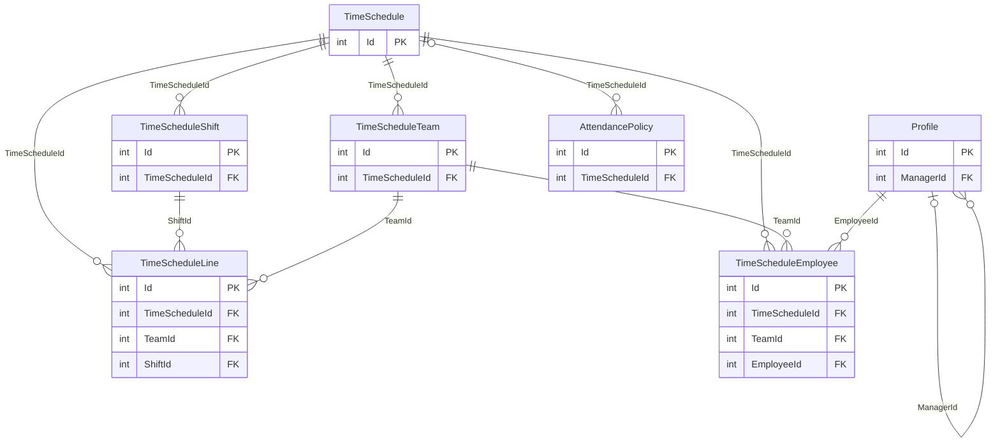
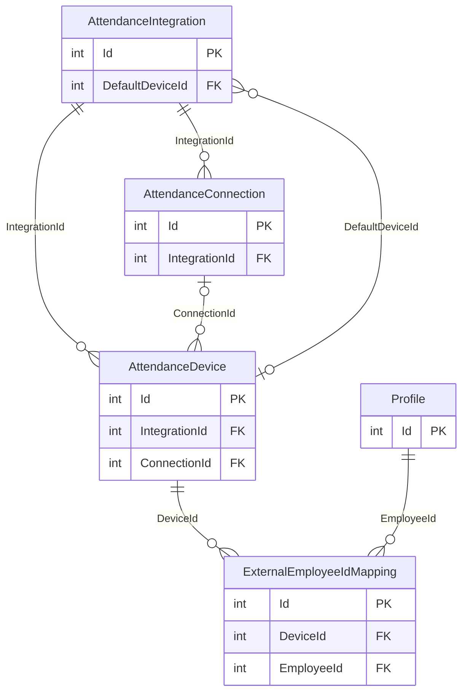
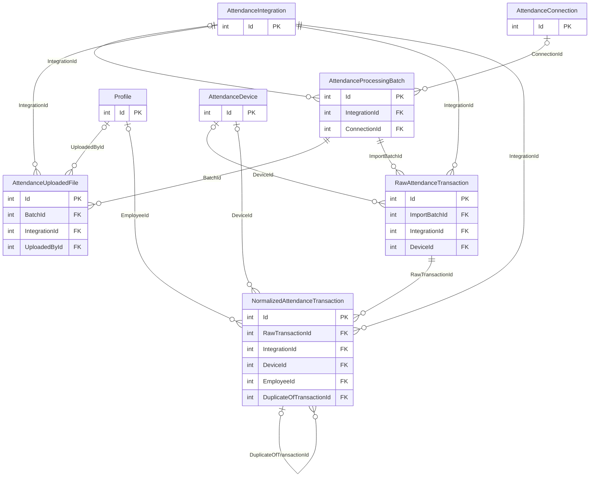
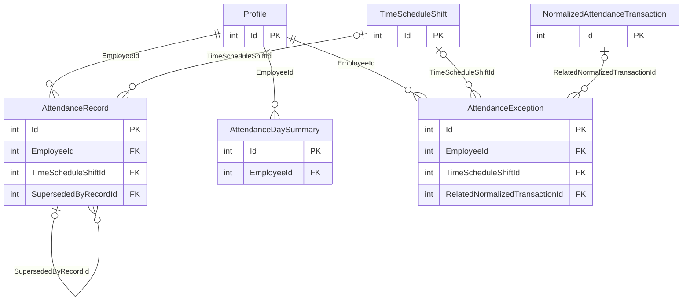
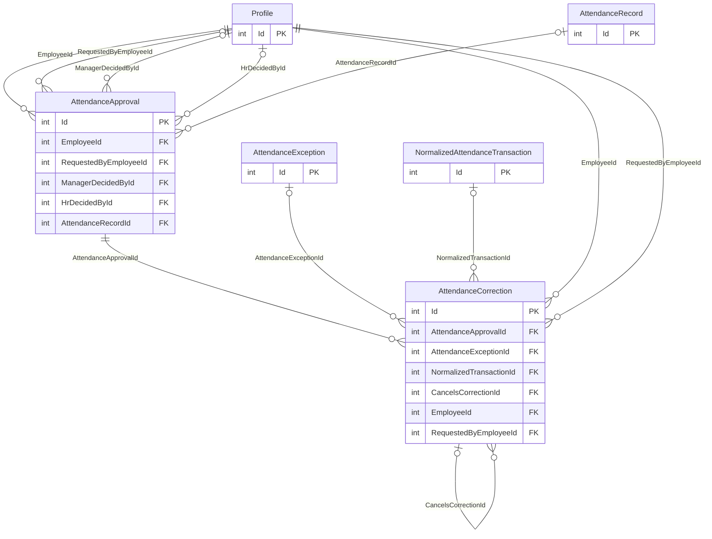
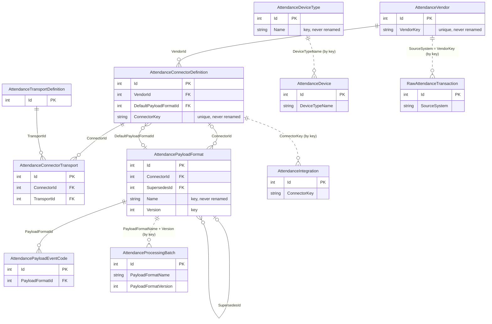

# Database entity-relationship diagram

Generated on 2026-11-06 from a freshly migrated PostgreSQL database (every migration up to `UnifyApprovals`, plus `InitialCatalog`):
the tables and foreign keys below are read from the database itself (`pg_constraint`), not written by hand.
The diagrams are [Mermaid](https://mermaid.js.org/syntax/entityRelationshipDiagram.html) and render on GitHub and in VS Code.

## How to read it

- **Two kinds of database.** Every tenant has its own database with the schemas `HR` and `Attendance` (23 tables, diagrams 1 to 6). The attendance **catalog** (schema `Catalog`, 7 tables, diagram 7) lives only in the **prime tenant's** database and is read by every other tenant over HTTP. No foreign key can cross databases, so tenant tables refer to the catalog **by key** (dotted lines in diagram 7).
- **`TenantId`** is on every table (CLAUDE.md §2.8) but is deliberately left out of the diagrams: it is not a foreign key, it is the tenant a row belongs to. Composite unique indexes start with it.
- **Lines.** `||` is a required parent, `|o` an optional one (the column is nullable), `o{` many children. The label is the foreign-key column on the child. Every foreign key is `ON DELETE RESTRICT`: nothing cascades.
- **Columns.** Only primary keys (`PK`) and foreign keys (`FK`) are shown, to keep the diagrams readable. Every table also has its own business columns. Fifteen of the 23 tenant tables also have the audit columns `CreatedOn`, `CreatedBy`, `ModifiedOn`, `ModifiedBy` and `GUID` (the `Entity` base class); the eight high-volume, system-generated ones do not, because they derive them instead of storing them (`SystemEntity`): `RawAttendanceTransaction`, `NormalizedAttendanceTransaction`, `AttendanceProcessingBatch`, `AttendanceUploadedFile`, `AttendanceJobRun`, `AttendanceAuditLog`, `TimeScheduleLine` and `TimeScheduleEmployee`.
- **Employee** is `HR.Profile`: every `EmployeeId` points to it, whatever the role it plays (`RequestedBy…`, `ManagerDecidedBy…`, `UploadedById`…).

## 1. Overview of the tenant database

All 23 tables and every foreign key, without columns. `PayPeriod` and `AttendanceAuditLog` have no foreign keys by design.

```mermaid
erDiagram
    Profile |o--o{ Profile : "ManagerId"

    TimeSchedule ||--o{ TimeScheduleShift : "TimeScheduleId"
    TimeSchedule ||--o{ TimeScheduleTeam : "TimeScheduleId"
    TimeSchedule ||--o{ TimeScheduleLine : "TimeScheduleId"
    TimeSchedule ||--o{ TimeScheduleEmployee : "TimeScheduleId"
    TimeSchedule |o--o{ AttendancePolicy : "TimeScheduleId"
    TimeScheduleShift ||--o{ TimeScheduleLine : "ShiftId"
    TimeScheduleTeam ||--o{ TimeScheduleLine : "TeamId"
    TimeScheduleTeam ||--o{ TimeScheduleEmployee : "TeamId"
    Profile ||--o{ TimeScheduleEmployee : "EmployeeId"

    AttendanceIntegration ||--o{ AttendanceConnection : "IntegrationId"
    AttendanceIntegration ||--o{ AttendanceDevice : "IntegrationId"
    AttendanceConnection |o--o{ AttendanceDevice : "ConnectionId"
    AttendanceDevice |o--o{ AttendanceIntegration : "DefaultDeviceId"
    AttendanceDevice ||--o{ ExternalEmployeeIdMapping : "DeviceId"
    Profile ||--o{ ExternalEmployeeIdMapping : "EmployeeId"

    AttendanceIntegration |o--o{ AttendanceProcessingBatch : "IntegrationId"
    AttendanceConnection |o--o{ AttendanceProcessingBatch : "ConnectionId"
    AttendanceProcessingBatch ||--o{ AttendanceUploadedFile : "BatchId"
    AttendanceIntegration ||--o{ AttendanceUploadedFile : "IntegrationId"
    Profile |o--o{ AttendanceUploadedFile : "UploadedById"

    AttendanceProcessingBatch ||--o{ RawAttendanceTransaction : "ImportBatchId"
    AttendanceIntegration ||--o{ RawAttendanceTransaction : "IntegrationId"
    AttendanceDevice |o--o{ RawAttendanceTransaction : "DeviceId"

    RawAttendanceTransaction ||--o{ NormalizedAttendanceTransaction : "RawTransactionId"
    AttendanceIntegration ||--o{ NormalizedAttendanceTransaction : "IntegrationId"
    AttendanceDevice |o--o{ NormalizedAttendanceTransaction : "DeviceId"
    Profile |o--o{ NormalizedAttendanceTransaction : "EmployeeId"
    NormalizedAttendanceTransaction |o--o{ NormalizedAttendanceTransaction : "DuplicateOfTransactionId"

    Profile ||--o{ AttendanceRecord : "EmployeeId"
    TimeScheduleShift |o--o{ AttendanceRecord : "TimeScheduleShiftId"
    AttendanceRecord |o--o{ AttendanceRecord : "SupersededByRecordId"
    Profile ||--o{ AttendanceDaySummary : "EmployeeId"

    Profile ||--o{ AttendanceException : "EmployeeId"
    TimeScheduleShift |o--o{ AttendanceException : "TimeScheduleShiftId"
    NormalizedAttendanceTransaction |o--o{ AttendanceException : "RelatedNormalizedTransactionId"

    Profile ||--o{ AttendanceApproval : "EmployeeId"
    Profile |o--o{ AttendanceApproval : "RequestedByEmployeeId"
    Profile |o--o{ AttendanceApproval : "ManagerDecidedById"
    Profile |o--o{ AttendanceApproval : "HrDecidedById"
    AttendanceRecord |o--o{ AttendanceApproval : "AttendanceRecordId"
    AttendanceApproval ||--o{ AttendanceCorrection : "AttendanceApprovalId"
    AttendanceException |o--o{ AttendanceCorrection : "AttendanceExceptionId"
    NormalizedAttendanceTransaction |o--o{ AttendanceCorrection : "NormalizedTransactionId"
    AttendanceCorrection |o--o{ AttendanceCorrection : "CancelsCorrectionId"
    Profile ||--o{ AttendanceCorrection : "EmployeeId"
    Profile ||--o{ AttendanceCorrection : "RequestedByEmployeeId"

    Profile |o--o{ AttendanceJobRun : "RequestedById"

    PayPeriod
    AttendanceAuditLog
```



## 2. People and time schedules (`HR`, plus the policy)

An employee is assigned to **one** schedule and one team (`TimeScheduleEmployee`, unique per tenant and employee). A schedule's *lines* say which shift a team works on which day of the cycle; a team with no line on a cycle day has the day off. A policy belongs to one schedule, or to none (the tenant-wide default).



## 3. Devices and integrations

An integration is how a vendor's data reaches robeem; it has one or more connections (how it is reached and authenticated) and the devices that punch through it. A device names the connection it uses, and an upload integration may name a default device for its files. The employee id a device reports is mapped to a `Profile` **per device**.



## 4. From a file or a webhook to a normalized punch

Raw punches are stored exactly as received and never changed. Normalization writes a vendor-neutral row for each, resolved to a device and an employee (both optional: an unrecognized one is flagged, not dropped). A duplicate points at the punch it duplicates.



## 5. The calculated day: records, summaries and exceptions

The engine turns an employee's punches into one `AttendanceRecord` per shift (a changed recalculation is a **new version** that points back from the one it replaces) and rolls them up into an `AttendanceDaySummary`. A problem it finds becomes an `AttendanceException`, which may name the punch it is about. The summary has no foreign key to its records: they are tied by employee and date.



## 6. Approvals: corrections and reviews

One `AttendanceApproval` is what an approver decides, for both kinds (`Type` = `Correction` or `Review`). A **correction** request is the `AttendanceCorrection` rows that point to it (its edits, decided together); a **review** points to the `AttendanceRecord` version it covers. The approval holds the status and the manager's and HR's decisions; the correction rows hold only what is asked.



### Tables with no relationships to the rest

| Table | What it is |
|---|---|
| `PayPeriod` | A pay period (start, end, closed): the stand-in for a Payroll module. Payroll reads attendance through `IPayrollAttendanceExtract`, never through these tables. |
| `AttendanceAuditLog` | Insert-only log of every decision, status change and read of raw or normalized data. It names what it is about by type and id, not by foreign key. |
| `AttendanceJobRun` | One run of a background job for the tenant. Its only link is the optional `RequestedById` to `Profile`. |

## 7. The attendance catalog (prime tenant's database, schema `Catalog`)

The catalog is robeem's offering to every tenant: vendors, their connectors (software or protocols), how data reaches robeem, the payload formats a connector's files are read by, and the kinds of device. It has no `TenantId` and is written only in the prime tenant. A format is **versioned**: a change to how a file is read is a new row that points back to the one it supersedes.

**Dotted lines are not foreign keys.** Tenant tables hold a *key* into the catalog (a connector's key, a device type's name, a format's name and version), because a database cannot enforce a foreign key into another database. Keys are never renamed.



## Regenerating

The diagrams came from a database created by the migrations, so they cannot drift from them. To refresh after a migration: run the Api against empty databases, then read the foreign keys:

```sql
SELECT child.relname, a.attname, parent.relname,
       CASE WHEN a.attnotnull THEN 'required' ELSE 'optional' END
FROM pg_constraint con
JOIN pg_class child  ON child.oid  = con.conrelid
JOIN pg_class parent ON parent.oid = con.confrelid
JOIN pg_namespace ns ON ns.oid = child.relnamespace
JOIN pg_attribute a  ON a.attrelid = con.conrelid AND a.attnum = con.conkey[1]
WHERE con.contype = 'f' AND ns.nspname IN ('HR', 'Attendance')   -- 'Catalog' for the catalog
ORDER BY child.relname, a.attname;
```
