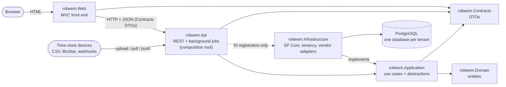
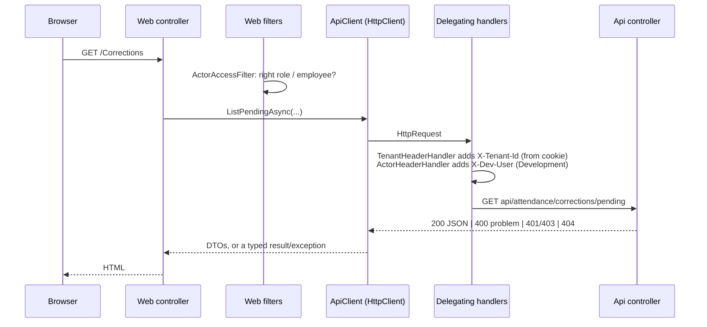
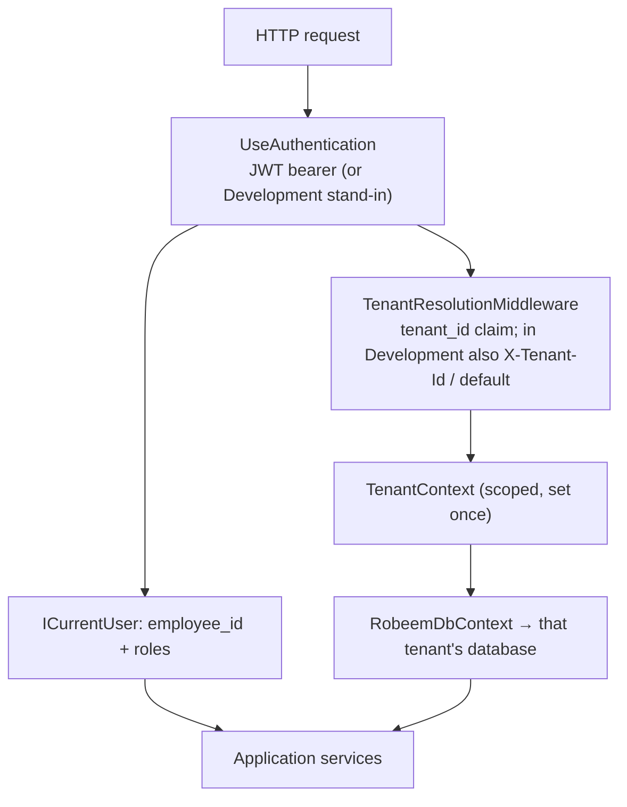
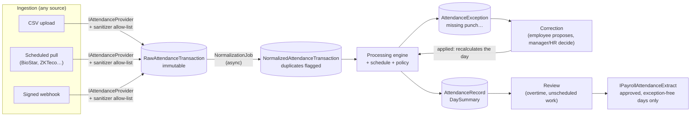

# robeem — Attendance & Time Clock Integration

A multi-tenant ASP.NET Core solution that brings punches from time-clock machines into robeem's HR module: it stores every raw punch, normalizes it, compares it with the employee's scheduled shift, raises exceptions for missing punches, lets people correct and approve them, and hands payroll only fully approved days.

This document explains **how the code is organised, what each project is for, and how the layers talk to each other**. For rules and decisions see [`CLAUDE.md`](CLAUDE.md); to run it see [`SETUP.md`](SETUP.md); for what is tested see [`TEST_COVERAGE.md`](TEST_COVERAGE.md).

---

## 1. The solution at a glance



| Project | One-line purpose | Talks to |
|---|---|---|
| `robeem.Domain` | The entities (what is stored). | nothing |
| `robeem.Contracts` | The DTOs and protocol constants shared between Api and Web (what travels over HTTP). | nothing |
| `robeem.Application` | The use cases and the interfaces they need from the outside world. | Domain, Contracts |
| `robeem.Infrastructure` | The implementations of those interfaces: database, tenancy, vendor adapters, secrets. | Application (so Domain, Contracts) |
| `robeem.Api` | The only running back end: REST controllers, authentication, tenant resolution, background jobs. Wires everything together. | Application, Infrastructure, Contracts |
| `robeem.Web` | The user interface. Has no database and no business logic; it calls the Api. | Contracts, then the Api over HTTP |
| `robeem.Analyzers` | A Roslyn suppressor so StyleCop's naming rule accepts the lower-case brand name `robeem`. Build-time only. | — |
| `tests/robeem.Tests` | xUnit tests across all layers (in-memory SQLite; PostgreSQL tests are opt-in). | all |

### Dependency rules

An arrow means "references". Nothing else is allowed, and architecture tests (NetArchTest) enforce the important ones.

```
Domain          → (nothing)
Contracts       → (nothing)
Application     → Domain, Contracts
Infrastructure  → Application
Api             → Application, Infrastructure, Contracts
Web             → Contracts
```

Consequences worth remembering:

- **Application never references Infrastructure.** It declares what it needs as interfaces (`IRobeemDbContext`, `ITenantScopeFactory`, `ISecretStore`, `IAttendanceProvider`, …) and Infrastructure supplies them.
- **Web never references Application, Infrastructure or Domain.** The only way to data is HTTP to the Api.
- **The Api returns DTOs, never entities.**
- **HR does not depend on Attendance.** Attendance may use HR types (`Profile`, `TimeSchedule*`); never the reverse.

---

## 2. Project by project

### `robeem.Domain` — the data model

Plain entity classes in the namespace `robeem.DataModel`. No dependencies, no behaviour beyond small computed properties.

- `Core/` — `Entity` and `SystemEntity` base classes (`SystemEntity` is for high-volume, system-generated rows without audit columns), `TimeShiftEntity`, `ITenantScoped`, `ISeedData`, `IWorkflowEntity`, `SmartEnum` (the schema/module names), and the `Set` time helpers.
- `HR/` — `Profile` (the employee) and the existing roster model: `TimeSchedule`, `TimeScheduleShift`, `TimeScheduleTeam`, `TimeScheduleLine`, `TimeScheduleEmployee`.
- `Attendance/` — the attendance entities, in their own `Attendance` database schema:

| Group | Entities |
|---|---|
| Configuration | `AttendanceProvider` (vendor catalog), `AttendanceIntegration` (a tenant's connection to a vendor), `AttendanceDevice`, `AttendancePolicy`, `ExternalEmployeeIdMapping` |
| Ingestion | `AttendanceProcessingBatch`, `RawAttendanceTransaction` (immutable) |
| Normalization | `NormalizedAttendanceTransaction` |
| Processing | `AttendanceRecord` (versioned), `AttendanceDaySummary`, `AttendanceException` |
| Human decisions | `AttendanceCorrection`, `AttendanceReviewDecision` |
| Payroll gate and audit | `PayPeriod`, `AttendanceAuditLog` (insert-only) |

The shift/roster system was already there, so attendance **reuses** it instead of inventing a second one (see [`CLAUDE.md`](CLAUDE.md) §3).

### `robeem.Contracts` — the wire format

Request/response DTOs (`ProposeCorrectionRequest`, `CorrectionListItem`, `RecordDayDetail`, `EmployeeInput`, …) grouped by area (`HR`, `Attendance`, `Tenancy`, `Security`, `Common`), plus the small protocols both sides must agree on:

- `TenancyProtocol` — the `X-Tenant-Id` header name and the error `code` values (`tenant_required`, `unknown_tenant`, `tenant_unavailable`).
- `ActorProtocol` — the Development-only `X-Dev-User` header ("act as" switcher) and the role names.

This is the **only** project Web shares with the back end, so a DTO change is visible to both sides at compile time.

### `robeem.Application` — the use cases

All business rules live here. Services take `IRobeemDbContext` (an abstraction over the database) and other interfaces; they never see EF providers, HTTP or ASP.NET.

| Area | Services (interface → what it does) |
|---|---|
| HR | `IEmployeeService` (employees and their schedule/manager), `ITimeScheduleService` (shifts, teams, roster) |
| Integration | `IAttendanceIntegrationService` (integrations, devices, mappings, mapping guide), `IIntegrationSyncService` (incremental pull with retry and circuit breaker), `IIntegrationHealthService` |
| Ingestion | `IIngestionService` (CSV upload to raw rows), `IWebhookReceiver` (signed push), `IRawPayloadSanitizer` (allow-lists fields; no biometric templates) |
| Normalization | `INormalizationService` (raw → vendor-neutral events, employee/device resolution, duplicate detection), `INormalizedTransactionRecorder` |
| Processing | `IScheduleResolutionService` (which shift should employee E work on date D), `IAttendancePolicyResolver`, `IAttendanceProcessingEngine` (punches vs. shifts → records and day summary), plus the pure `ShiftAttendanceCalculator` and `AttendanceExceptionDetector` |
| Human workflow | `IAttendanceExceptionQuery`, `IAttendanceCorrectionService`, `IAttendanceReviewService`, `IAttendanceRecordService`, `IAttendancePolicyService` |
| Payroll | `IPayrollAttendanceExtract` (the **only** way payroll reads attendance; approved, exception-free days of an open pay period), `IPayPeriodService` |
| Cross-cutting | `ICurrentUser`, `ISecretStore`, `IAttendanceAuditTrail`, `ITenantContext`, `ITenantRegistry`, `ITenantScopeFactory`, `ISeedContributor` |

It also declares the two **extension points for vendors**: `IAttendanceProvider` (how to fetch data from a vendor) and `IAttendanceEventInterpreter` (how that vendor writes timestamps and event types). Registration happens in `AddRobeemApplication()`.

### `robeem.Infrastructure` — the outside world

Implements the interfaces Application declared.

- `Persistence/` — `RobeemDbContext` (EF Core + Npgsql), entity configurations, migrations, `TenantDatabaseInitializer` (migrates and seeds every tenant database at startup in Development).
- `Tenancy/` — `TenantRegistry` (tenants from configuration), `TenantContext` (the current tenant of a scope), `TenantScopeFactory` (a DI scope bound to one tenant, used by background jobs).
- `Attendance/Providers/` — the vendor adapters, each an `IAttendanceProvider` plus an `IAttendanceEventInterpreter`: `GenericCsv`, `Zkteco`, `SupremaBiostar` (HTTPS pull), `GenericWebhook` (push).
- `Security/` — `ConfigurationSecretStore` (resolves a secret reference to the secret; never logs it).
- `Seeding/` — `SeedDataRunner`, which runs `ISeedContributor`s and rejects any that touch an entity not marked `ISeedData`.

`AddRobeemInfrastructure()` registers all of it, including each adapter and interpreter as **keyed services under the vendor's `ProviderKey`**.

### `robeem.Api` — the back end and composition root

The one process that touches a database. It is a *resource server*: it validates JWT bearer tokens from an external identity provider and issues none.

- `Controllers/` — thin REST controllers under `api/...`. Each action names its roles with `[Authorize(Roles = …)]`, takes and returns Contracts DTOs, and delegates to one Application service. The inbound webhook is the single anonymous endpoint, authenticated by an HMAC signature instead.
- `Tenancy/` — `TenantResolutionMiddleware` decides the tenant of every request.
- `Security/` — JWT setup, `HttpCurrentUser` (the claims as `ICurrentUser`), `AttendanceRoles`, the Development stand-in user.
- `Attendance/Jobs/` — `ScheduledJobsHostedService` runs `NormalizationJob`, `IntegrationSyncJob` and `ReconciliationJob`. Each job walks the tenants and works inside its own tenant scope; the logic stays in Application services.
- `Program.cs` — wires `AddRobeemInfrastructure`, `AddRobeemApplication` and authentication, then the pipeline.

### `robeem.Web` — the user interface

An MVC app with no database and no business rules.

- `Controllers/` + `Views/` — the screens: Employees, Time schedules, Attendance records, Exceptions, Corrections, Reviews, Integrations, Policies, Payroll, Pay periods, Audit.
- `ApiClients/` — one typed `HttpClient` per Api area (`CorrectionsApiClient`, …). They translate HTTP outcomes into something controllers can use (see §3.1).
- `Navigation/` — `NavigationMenu`, the single list the menu and start page read; a screen shows only for the acting roles it lists.
- `Actors/`, `Tenancy/` — the Development "act as" switcher and the tenant picker, with the handlers and filters that forward them to the Api.

---

## 3. How the layers communicate

### 3.1 Web → Api: HTTP with Contracts DTOs

The Web reaches data **only** through the Api. Each Web controller calls a typed client; the client does the HTTP.



What the Web adds around the call:

- **Tenant** — the `robeem.tenant` cookie (set by the `/Tenants` picker) is sent as `X-Tenant-Id` by `TenantHeaderHandler`. If the Api rejects the tenant (`tenant_required`/`unknown_tenant`), `TenantSelectionRequiredFilter` redirects to the picker.
- **Acting user (Development only)** — the "act as" cookie is sent as `X-Dev-User` by `ActorHeaderHandler`. The Api honours it only through its development stand-in user. Real sign-in will replace it with an access token (not built yet).
- **Outcomes** — `ApiResponses` maps statuses: a 400 becomes messages to show (`ApiCommandResult`), 401/403 throws `ApiAccessDeniedException` (carrying the Api's reason), 404 throws `ApiNotFoundException`. `ApiAccessDeniedFilter` turns those into the "Not allowed" / not-found pages.
- **Pre-checking** — `ActorAccessFilter` spares a round trip: if the acting choice lacks a role the menu lists for the screen, or has no employee for a screen marked `[RequiresEmployee]`, it shows "Not allowed" without calling the Api. The Api remains the authority; this only improves feedback.

### 3.2 Api → Application: controllers call use-case interfaces

A controller does three things only: authorize by role, translate DTO ↔ service call, translate the service's result into a status code.

```csharp
[ApiController, Authorize, Route("api/attendance/corrections")]
public sealed class AttendanceCorrectionsController : ControllerBase
{
    [HttpPost, Authorize(Roles = AttendanceRoles.Employee)]
    public async Task<ActionResult<CreatedResponse>> Propose(ProposeCorrectionRequest request, CancellationToken ct)
    {
        // Who is asking comes from the token (ICurrentUser), never from the request body.
        var result = await _corrections.ProposeCorrectionAsync(request.ExceptionId, request.ProposedValue,
            request.Justification, _user.EmployeeId!.Value, ct);
        ...
    }
}
```

The identity (`employee_id`, roles, tenant) is carried by the token's claims and exposed to Application as `ICurrentUser`, so use cases know the actor without referencing ASP.NET.

### 3.3 Application → Infrastructure: through abstractions, wired at the root

Application services depend on interfaces; the Api's `Program.cs` is the only place that connects them to implementations.

| Application declares | Infrastructure provides |
|---|---|
| `IRobeemDbContext` | `RobeemDbContext` (EF Core, Npgsql, one connection string per tenant) |
| `ITenantContext`, `ITenantRegistry`, `ITenantScopeFactory` | `TenantContext`, `TenantRegistry`, `TenantScopeFactory` |
| `ISecretStore` | `ConfigurationSecretStore` |
| `IAttendanceProvider`, `IAttendanceEventInterpreter` | one pair per vendor, **keyed by `ProviderKey`** |
| `ISeedContributor` | run by `SeedDataRunner` |

Vendor adapters are looked up by key at run time: ingestion resolves the adapter and normalization resolves the interpreter using the integration's provider key. Adding a vendor is two classes and two registrations; processing, exception, correction and payroll code never change.

### 3.4 Infrastructure → database: one database per tenant

`RobeemDbContext` connects to the database of the scope's tenant. Resolving it with no tenant throws (fails closed). On top of database-per-tenant, **every table also carries a `TenantId`**: reads are filtered by it, writes are stamped with it, and writing another tenant's row throws.

### 3.5 Tenant and identity through the layers



Background jobs have no request, so they iterate `ITenantRegistry.Tenants` and open `ITenantScopeFactory.CreateScope(tenant.Id)` per tenant. A scope is never shared between tenants.

### 3.6 Background jobs → Application

`ScheduledJobsHostedService` (a single in-process scheduler) runs jobs that only decide *what is due* and then call Application services inside a tenant scope:

| Job | Calls | Cadence |
|---|---|---|
| `NormalizationJob` | `INormalizationService` | every few seconds |
| `IntegrationSyncJob` | `IIntegrationSyncService` (Polly retry + circuit breaker per integration) | short tick; each integration is due by its own cron |
| `ReconciliationJob` | `IIntegrationSyncService` / cleanup | nightly |

---

## 4. The attendance data flow

Ingestion and processing are deliberately decoupled so a bad or duplicate punch can never be lost.



Invariants this shape guarantees (full list in [`CLAUDE.md`](CLAUDE.md) §1):

1. Every raw event is stored, unconditionally; raw rows are never updated or deleted.
2. Normalization is asynchronous and is the only place duplicates are decided.
3. A missing punch is never invented; it becomes an exception a human resolves.
4. Corrections and review decisions are new rows with an actor and reason; nothing is rewritten. A changed recalculation creates a new record version and retires the old one.
5. Payroll reads only through `IPayrollAttendanceExtract`; architecture tests stop Web, Contracts and non-attendance code from touching raw or normalized rows.
6. No biometric template is ever stored; adapters copy allow-listed fields only.

### Worked example: a manager approves a correction

1. The employee's exception shows a missing check-out. They propose the missing time → `POST api/attendance/corrections` (role `Employee`).
2. The manager opens **Corrections** in the Web → `GET api/attendance/corrections/pending?awaiting=Manager`. The Api scopes the queue to the manager's direct reports using `ICurrentUser.EmployeeId`.
3. They approve → `POST api/attendance/corrections/{id}/decision`.
4. `IAttendanceCorrectionService`, in **one transaction**: records the decision, applies the correction, closes the exception, asks `IAttendanceProcessingEngine` to recalculate the day, and stages an audit entry through `IAttendanceAuditTrail`.
5. The Api answers with a `CorrectionDecisionResponse`; the Web shows the outcome message.

---

## 5. Cross-cutting concerns

| Concern | Where | How |
|---|---|---|
| Multi-tenancy | Api middleware, Infrastructure | Database per tenant plus a `TenantId` on every row; query filter, write guard, per-tenant scopes for jobs. |
| Authentication | Api | JWT bearer from an external IdP (Entra ID is the target). Claims: `tenant_id`, `role`, `employee_id`. In Development a stand-in user replaces the token. |
| Authorization | Api controllers | `[Authorize(Roles = …)]` on every action (a test fails otherwise): Employee, Manager, HRAdministrator, PayrollAdministrator, IntegrationAdministrator. Managers see only direct reports. |
| Audit | Application, Domain | `AttendanceAuditLog` is insert-only; every correction decision, exception status change and direct read of raw/normalized data writes an entry in the caller's transaction. |
| Secrets | Application + Infrastructure | An integration stores a *reference*; `ISecretStore` resolves it for one call; never logged or stored in a table. |
| Resilience | Application | Polly retry with backoff and a circuit breaker per tenant + integration; health is stored on the integration. |
| Code style | whole solution | StyleCop.Analyzers via `Directory.Build.props` and a tiered `.editorconfig`. |

---

## 6. Extending the system

- **A new time-clock vendor** — implement `IAttendanceProvider` and `IAttendanceEventInterpreter` in `robeem.Infrastructure/Attendance/Providers`, register both as keyed services under the same `ProviderKey`, and flip the vendor's seed flag in `AttendanceSeedContributor`. Nothing else changes.
- **A new screen** — add DTOs to Contracts, a service to Application (register it in `AddRobeemApplication`), a controller with role attributes to Api, then an `I…ApiClient`/`…ApiClient` pair, a controller and views to Web, and one `NavItem` in `NavigationMenu`.
- **A new entity** — put it in `robeem.Domain`, implement `ITenantScoped`, add its `DbSet` to `IRobeemDbContext` and `RobeemDbContext`, add an `IEntityTypeConfiguration`, then a migration.

## 7. Known limits

- **Web sign-in is not built.** The Web has no login and does not forward tokens, so it works in Development only (with the "act as" switcher).
- **Run one Api instance.** The scheduler has no distributed lock; two instances could normalize the same raw row twice.
- **Nothing schedules the processing engine yet.** Normalization produces normalized events, but a day is calculated only when HR reprocesses it or after a correction or review decision. A job that processes newly normalized days is the natural next step.
- Missed scheduled runs are not replayed (incremental sync catches up through its cursor; reconciliation waits for the next night).

## 8. Where to read more

| File | What it holds |
|---|---|
| [`CLAUDE.md`](CLAUDE.md) | The contract: invariants, conventions, layering rules, decisions. |
| [`SETUP.md`](SETUP.md) | Prerequisites, configuration, running, troubleshooting. |
| [`TEST_COVERAGE.md`](TEST_COVERAGE.md) | Which tests cover which scenarios and invariants, and the known gaps. |
| `ATTENDANCE_P*_NOTES.md`, `ATTENDANCE_FOLLOWUP_NOTES.md` | Per-step deviations and decisions. |
| `PROMPT_PLAN.md`, `DISCOVERY_NOTES.md` | How the work was planned and the early decisions. |
